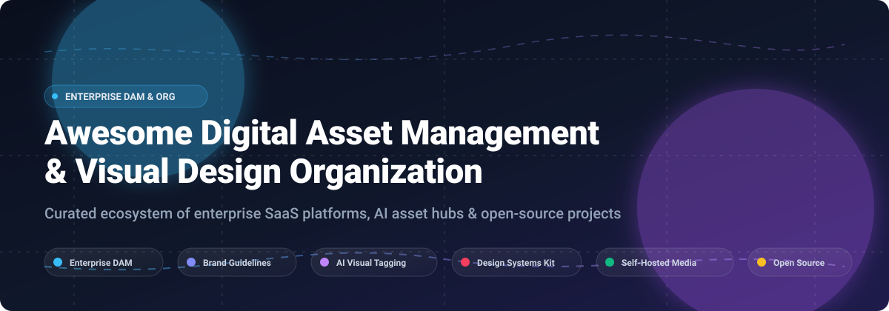

# Awesome Digital Asset Management & Design Organization 🗂️✨

  

  
  
  
  
  
  

---

## 🌟 Overview & Purpose

A curated, comprehensive guide to **Digital Asset Management (DAM)** platforms, **Visual Design Asset Organizers**, **Brand Portals**, **AI-Powered Visual Tagging Systems**, and **Self-Hosted Media Repositories**.

Whether you are an enterprise creative operations lead orchestrating petabytes of brand guidelines, marketing assets, and Figma/Adobe CC kits, or an independent designer, photographer, or self-hoster seeking privacy-first open-source alternatives, this repository indexes the best-in-class hosted SaaS and self-hosted tools.

---

## 📑 Table of Contents

- [📊 Sector Overview & Market Dynamics](#-sector-overview--market-dynamics)
- [🏢 SaaS & Hosted Platforms](#-saas--hosted-platforms)
- [💻 Open-Source GitHub Projects](#-open-source-github-projects)
- [🛠️ Architectural Blueprints & Stacks](#️-architectural-blueprints--stacks)
- [🤝 How to Contribute](#-how-to-contribute)
- [💖 Support & Community](#-support--community)
- [📈 Star History](#-star-history)
- [📜 Disclaimer & Best Practices](#-disclaimer--best-practices)

---

## 📊 Sector Overview & Market Dynamics

The global Digital Asset Management (DAM) market is estimated at **$6.2 billion to $6.8 billion in 2025** and projected to surpass **$7.5 billion to $8.0 billion in 2026**, expanding at a Compound Annual Growth Rate (CAGR) of 14%–18% driven by generative AI metadata pipelines, cloud migration, and omnichannel e-commerce content velocity.

The sector is **highly fragmented** rather than winner-take-all: while enterprise titans like Adobe command deep enterprise footprints, distinct vertical workflows (brand guidelines, high-velocity ad creative operations, archival photo curation, and self-hosted privacy storage) enable dedicated mid-market leaders, agile VC-backed SaaS upstarts, and thriving open-source ecosystems to coexist and continuously capture market share.

---

## 🏢 SaaS & Hosted Platforms

Below is an overview of leading commercial SaaS Digital Asset Management and creative workflow platforms, ranked by company scale (market capitalization / company valuation / estimated revenue):

| Platform | Company Scale (Valuation / Revenue) 🏢 | Pricing (Starting Tier) 💳 | Free Tier / Trial Limits 🎁 | Key Strengths & Focus Areas 🎯 |
| :--- | :--- | :--- | :--- | :--- |
| **[Adobe Experience Manager (AEM) Assets](https://adobe.com)** | **~$85B–$95B Market Cap** *(Public: NASDAQ: ADBE)* | Starting tier at **$100,000/year** (~$8,333/month, annual enterprise contract) | **No free tier**; custom sandbox trial available only via enterprise sales consultation (typically 30-day proof of concept) | Enterprise-scale DAM deeply integrated into Adobe Creative Cloud, Firefly Generative AI, dynamic media delivery, and global omnichannel content supply chains. |
| **[Brandfolder](https://brandfolder.com)** | **$8.4B Acquisition Valuation** *(Parent: Smartsheet / Blackstone & Vista)* | Starting tier at **$500/month** (Basic/Small Team tier, billed annually) | **No free plan**; offers a **14-day free trial** with full platform capabilities and custom guided demo | Brand Intelligence AI auto-tagging, CDN asset distribution, digital rights management, and unlimited free guest/view-only portal seats. |
| **[Acquia DAM](https://acquia.com)** *(formerly Widen Collective)* | **~$1.0B–$2.5B Valuation** *(Parent: Vista Equity Partners)* | Starting tier at **$2,400/month** (~$28,800/year annual SaaS subscription) | **No free plan**; custom guided pilot/trial available on request via sales consultation (typically 14 to 30 days) | Robust digital asset management combined with Product Information Management (PIM), governance workflows, metadata taxonomy builders, and multi-channel publishing. |
| **[Bynder](https://bynder.com)** | **~$600M+ Valuation** *(THL Partners / ~$60M+ ARR)* | Starting tier at **$450/month** (Starter package, billed annually) | **No free plan**; offers a **14-day free trial** for up to 5 users and 5 GB storage | Flagship cloud DAM featuring living brand style guides, generative creative automation (Studio), and AI visual recognition. |
| **[Frontify](https://frontify.com)** | **~$200M Valuation** *(Series C / ~$60M ARR)* | Starting tier at **$83/month** (~$1,000/year for basic Brand Guidelines tier; Growth DAM starts ~$660/month) | **No free plan**; offers a **14-day free trial** covering brand guidelines, asset libraries, and template builders | All-in-one brand operations hub connecting brand guidelines, digital asset libraries, design tokens, and web creative templates based on Monthly Active Users (MAUs). |
| **[Air.inc](https://air.inc)** | **~$100M–$250M Valuation** *(Series B / ~$75M raised)* | Free plan available; paid starting tier at **$25/month** (billed annually, 600 monthly credits) | **Free forever plan** with **120 monthly credits (~20 GB storage)**, unlimited collaborator seats, and core AI visual search | Visual-first creative operations workspace tailored for marketing & video teams, rapid Kanban asset boards, frame-accurate commenting, and cloud sharing. |
| **[Canto](https://canto.com)** | **~$85M Total Funding / ~$45M–$52M ARR** *(JMI Equity)* | Starting tier at **$1,000/month** (~$12,000–$25,000/year, AWS Marketplace & direct) | **No free plan**; offers a **7-day free trial** with sample media libraries and full AI search evaluation | Established DAM solution offering facial and visual recognition AI, customizable branded client portals, Adobe/Figma plugins, and unlimited viewer access. |
| **[MediaValet](https://mediavalet.com)** | **$80M CAD STG Acquisition** *(~$16.4M ARR, taken private 2024)* | Starting tier at **$400/month** (~$4,800–$6,000/year, annual contract) | **No free plan**; offers a **14-day proof-of-concept trial** upon sales onboarding | 100% Azure cloud-native DAM with unlimited user seats, 3D/CAD previews, automatic AI audio/video transcription, and enterprise security governance. |
| **[Aprimo](https://aprimo.com)** | **~$50M–$100M Valuation / ~$35M ARR** *(Marlin Equity Partners)* | Starting tier at **$1,665/month** (~$20,000/year, enterprise contract) | **No free plan**; customized sandbox environment available for enterprise RFP evaluations (typically 14–30 days) | Comprehensive enterprise content operations, digital rights expiration governance, AI metadata enrichment, and marketing resource allocation. |
| **[Eagle App](https://eagle.cool)** *(OGDesign)* | **Bootstrapped Indie / Privately Held** | One-time payment of **$29.95** (lifetime license, 2 device seats, free lifetime upgrades) | **30-day unrestricted free trial** with access to all desktop features, browser extension grabbers, and smart folders | Lightning-fast desktop design asset organizer with local folder storage, color-palette search, auto-tagging, font management, and browser extensions. |

---

## 💻 Open-Source GitHub Projects

Explore the open-source ecosystem for self-hosted Digital Asset Management, visual media servers, and design system infrastructure. Repositories are ranked below in descending order by GitHub stargazers count:

| Project & Repository 📦 | GitHub_Stars ⭐ | Primary Focus & Capabilities 🚀 | License ⚖️ | Tech Stack 💻 |
| :--- | :--- | :--- | :--- | :--- |
| **[Immich](https://github.com/immich-app/immich)**  | **~120k+** | High-performance, self-hosted photo & video backup hub featuring CLIP semantic natural-language search, facial clustering, partner sharing, and mobile sync. | AGPL-3.0 | TypeScript, Svelte, Dart/Flutter, Python |
| **[Stirling-PDF](https://github.com/Stirling-Tools/Stirling-PDF)**  | **~97k+** | Locally-hosted one-stop web application for all digital asset PDF manipulation: OCR, watermarking, conversions, compression, page extraction, and security encryption. | GPL-3.0 | Java, Spring Boot, Thymeleaf |
| **[Penpot](https://github.com/penpot/penpot)**  | **~62.7k+** | Open-source collaborative design & prototyping platform built natively on web standards (SVG/CSS) with shared team component libraries, typography tokens, and asset management. | MPL-2.0 | Clojure, ClojureScript |
| **[MinIO](https://github.com/minio/minio)**  | **~61.2k+** | High-performance S3-compatible multi-cloud object storage suite serving as the primary storage layer and media repository backend for modern enterprise DAM pipelines. | AGPL-3.0 | Go |
| **[Meilisearch](https://github.com/meilisearch/meilisearch)**  | **~60.0k+** | Ultra-fast, typo-tolerant search engine purpose-built for instant search-as-you-type indexing across vast DAM metadata, document catalogs, and design libraries. | MIT | Rust |
| **[PhotoPrism](https://github.com/photoprism/photoprism)**  | **~40.5k+** | AI-powered personal and team visual asset organizer written in Go and TensorFlow, supporting automated object/color labeling, RAW conversion, and WebDAV synchronization. | AGPL-3.0 | Go, Vue.js, TensorFlow |
| **[Nextcloud Server](https://github.com/nextcloud/server)**  | **~37.6k+** | Enterprise-grade self-hosted collaboration platform with integrated file versioning, brand folders, access control, and seamless integration with **[Memories](https://github.com/pulsejet/memories)**. | AGPL-3.0 | PHP, JavaScript, Vue.js |
| **[Ente Photos](https://github.com/ente-io/ente)**  | **~30.5k+** | Fully open-source, end-to-end encrypted (E2EE) photo and visual design asset storage with client-side AI search, shared collaborative albums, and family/team controls. | AGPL-3.0 | TypeScript, Go, Flutter |
| **[Thumbor](https://github.com/thumbor/thumbor)**  | **~10.5k+** | Battle-tested open-source dynamic imaging service capable of smart cropping, facial detection, real-time resizing, and automated format transcoding for DAM distribution. | MIT | Python |
| **[LibrePhotos](https://github.com/LibrePhotos/librephotos)**  | **~8.2k+** | Self-hosted AI-driven visual management server featuring semantic visual search, face recognition, map clustering, and multi-user access permissions. | MIT | Python, Django, React |
| **[Garage](https://github.com/deuxfleurs-org/garage)**  | **~4.9k+** | Lightweight, distributed S3-compatible object storage designed for self-hosting across multi-datacenter nodes to store distributed high-res asset files. | AGPL-3.0 | Rust |
| **[Imagor](https://github.com/cshum/imagor)**  | **~4.1k+** | Fast, Docker-ready image processing server powered by libvips with HTTP/S3 endpoints for on-the-fly thumbnail generation, AVIF/WebP conversions, and watermark overlays. | MIT | Go, libvips |
| **[Pimcore](https://github.com/pimcore/pimcore)**  | **~3.9k+** | Enterprise open-source Digital Asset Management (DAM), Product Information Management (PIM), and Master Data Management (MDM) framework with automated media rendition pipelines. | GPL-3.0 | PHP, Symfony |
| **[Memories](https://github.com/pulsejet/memories)**  | **~3.9k+** | Ultra-fast photo and video gallery ecosystem for Nextcloud featuring hardware-accelerated transcoding, timeline scrubbing, and vector semantic visual lookup. | AGPL-3.0 | Vue.js, PHP |
| **[Damselfly](https://github.com/Webreaper/Damselfly)**  | **~1.8k+** | Server-based visual asset management system tailored for multi-terabyte image collections with IPTC/XMP keyword tagging, facial recognition, and instant queries. | GPL-3.0 | C#, .NET, Blazor |
| **[Tropy](https://github.com/tropy/tropy)**  | **~1.2k+** | Desktop research and visual archive management software designed for grouping, annotating, transcribing, and cataloging high-resolution historical photos and documents. | AGPL-3.0 | JavaScript, Electron, C++ |
| **[BeeRef](https://github.com/rbreu/beeref)**  | **~830** | Minimalist cross-platform visual reference board and moodboard manager (open-source PureRef alternative) for organizing design inspiration canvases. | GPL-3.0 | Python, Qt (PySide) |
| **[digiKam](https://github.com/KDE/digikam)**  | **~810** | Professional open-source desktop photo management suite capable of processing 100,000+ RAW images with hierarchical tag trees, lens corrections, and XMP support. | GPL-2.0 | C++, Qt |
| **[Phraseanet](https://github.com/alchemy-fr/Phraseanet)**  | **~280** | Established open-source enterprise DAM application designed for cultural institutions, publishers, and media agencies requiring complex metadata thesauri and rights tracking. | GPL-3.0 | PHP, Symfony, Docker |
| **[ResourceSpace](https://github.com/resourcespace/resourcespace)**  | **~95** | Dedicated open-source enterprise Digital Asset Management system used by universities, museums, and NGOs for rich metadata extraction, custom approval workflows, and transcoding. | BSD-4-Clause | PHP, MySQL |

---

## 🛠️ Architectural Blueprints & Stacks

### 🏗️ Recommended Open-Source Self-Hosted Production Stack
1. **Object Storage Backend**: **[MinIO](https://github.com/minio/minio)** or **[Garage](https://github.com/deuxfleurs-org/garage)** for distributed S3-compatible asset storage.
2. **Core DAM / PIM Layer**: **[Pimcore](https://github.com/pimcore/pimcore)** or **[ResourceSpace](https://github.com/resourcespace/resourcespace)** for corporate metadata governance, role-based access, and client approvals.
3. **AI Visual Search & Tagging**: **[Immich](https://github.com/immich-app/immich)** or **[PhotoPrism](https://github.com/photoprism/photoprism)** for CLIP semantic natural-language asset queries and facial clustering.
4. **Dynamic Image Renditions & Delivery**: **[Imagor](https://github.com/cshum/imagor)** or **[Thumbor](https://github.com/thumbor/thumbor)** for on-the-fly resizing, WebP/AVIF transformations, and watermark burns.
5. **Design Systems & Vector Assets**: **[Penpot](https://github.com/penpot/penpot)** for open-standard team UI libraries, design tokens, and SVG graphics.

---

## 🤝 How to Contribute

We welcome community contributions! To suggest a new tool or update an existing entry:

1. **Fork the Repository** on GitHub.
2. **Add or Edit Entries** in `README.md` following the tabular format above.
3. **Verify Guidelines**:
   - Provide direct URLs to official software homepages and GitHub source repositories.
   - For SaaS products, include verified starting tier pricing, free tier/trial limits, and company scale metrics.
   - For open-source projects, include accurate GitHub repository Stars_Badges linking to the repository's stargazers page.
4. **Submit a Pull Request** with a descriptive summary of your changes.

---

## 💖 Support & Community

If you find this curated Digital Asset Management repository helpful, please consider supporting the project:

- ⭐ **Star this repository** on GitHub to help other designers, engineers, and ops teams discover it.
- 🍴 **Fork and share** the repo on LinkedIn, X/Twitter, Reddit, and design communities.
- ☕ **Buy me a coffee / Sponsor my work**: Support ongoing curation, open-source development, and tool benchmarking on the [GitHub Sponsors Dashboard](https://github.com/sponsors/ishandutta2007)!

  

---

## 📈 Star History

---

## 📜 Disclaimer & Best Practices

- This list is community-curated for informational and architectural evaluation purposes and does not constitute a formal commercial endorsement.
- All product names, logos, and brands are property of their respective owners.
- **Security & Compliance Note**: Digital Asset Management systems frequently house confidential product roadmaps, pre-launch campaign creative assets, and copyright-protected media. Always enforce Role-Based Access Control (RBAC), multi-factor authentication (MFA), end-to-end TLS encryption, automated offsite backups, and digital rights expiration policies across both self-hosted and cloud deployments.
